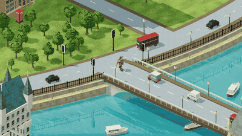
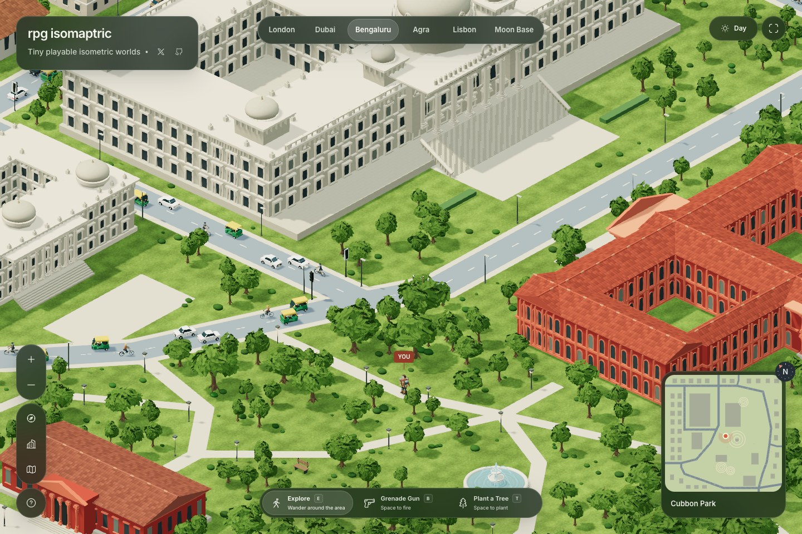
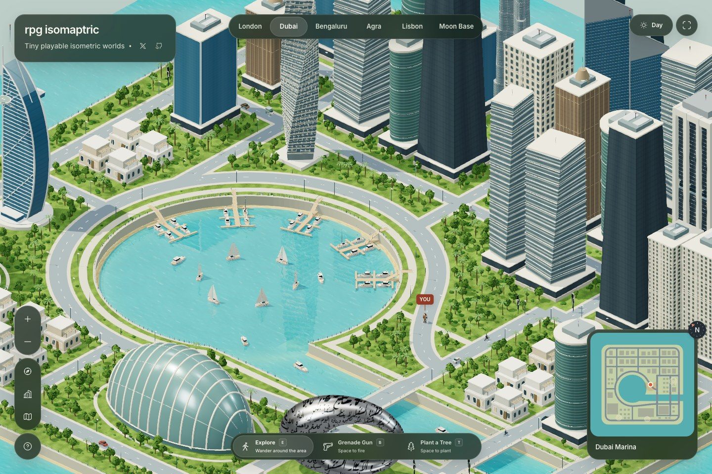
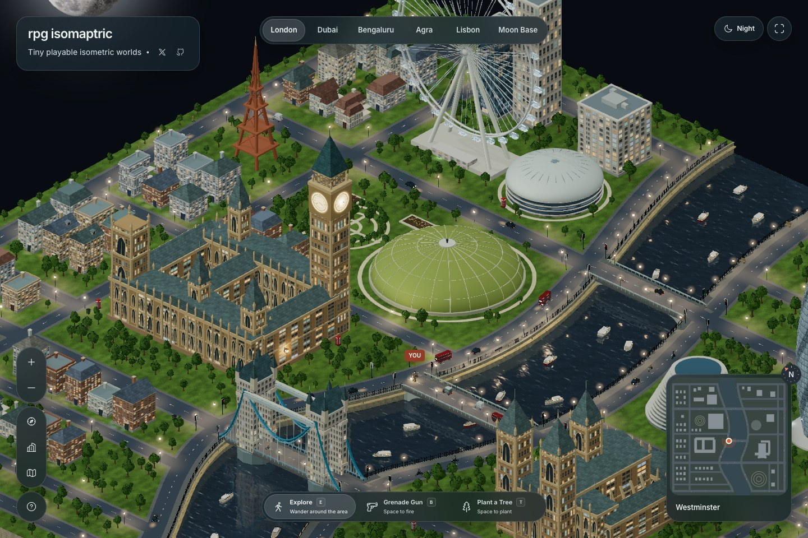
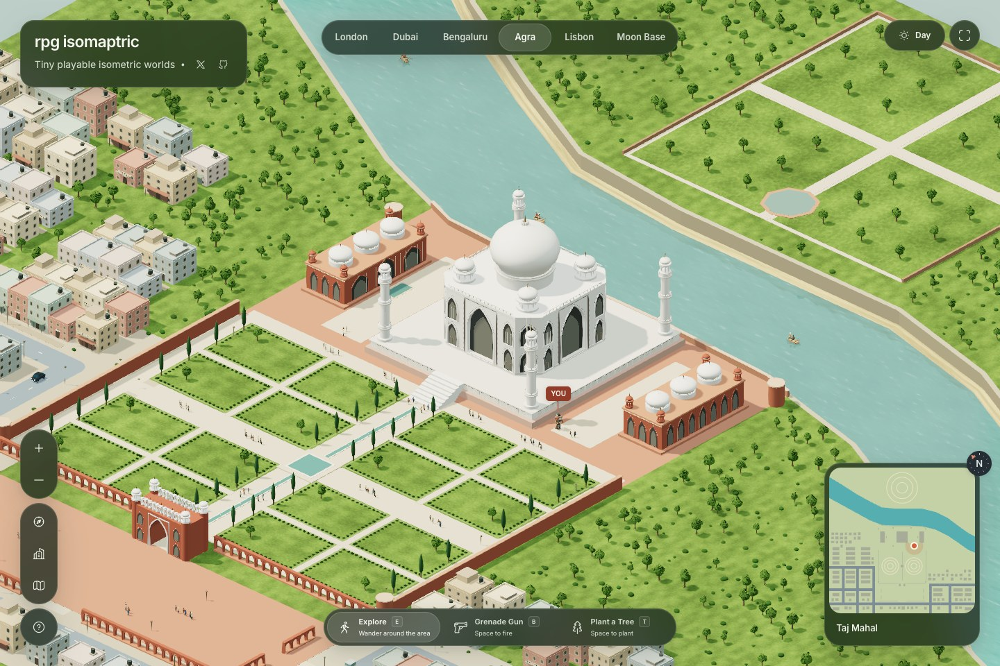
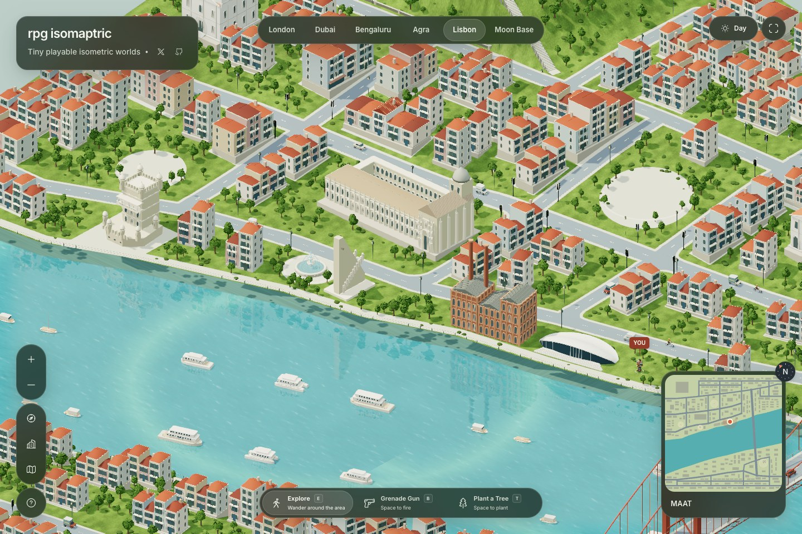
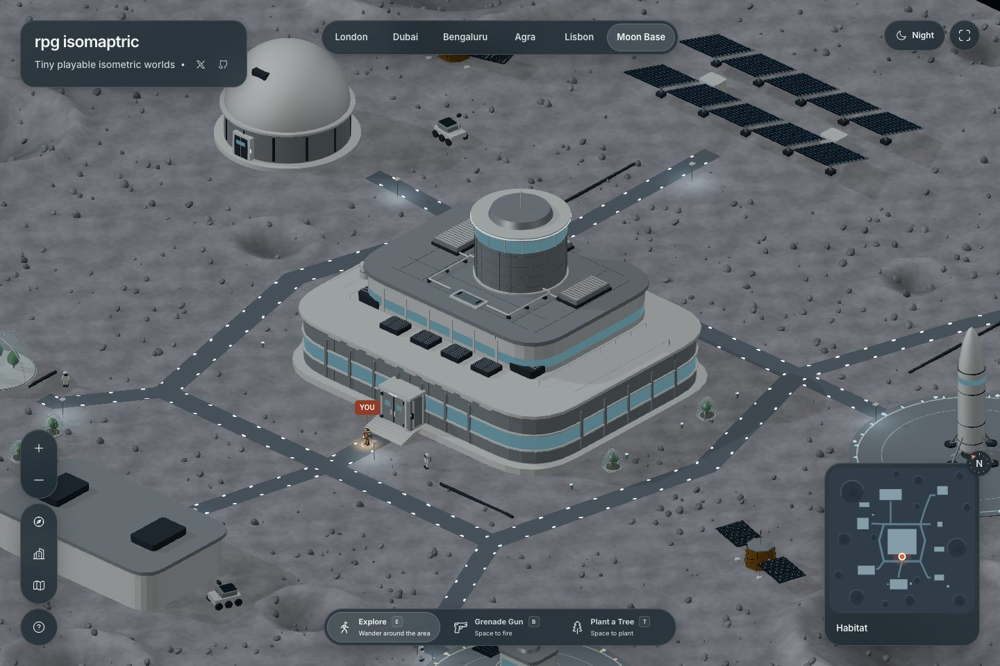

# rpg isomaptric

A playable collection of isometric dioramas built with Three.js: London, Dubai, Bengaluru, Agra, Lisbon, and a fictional Moon base. Wander through landmarks, switch between day and night, follow the traffic, plant trees, or take a grenade launcher to the scenery.

[Play in your browser](https://rpg-isomaptric.vercel.app) · [Gameplay video](https://youtu.be/l_WwsOZ4Jgw) · [Reusable glass UI](styles/glass-ui/) · [Build a world](docs/WORLD-AUTHORING.md)



## Around the worlds

Screenshots from the running app, including the glass controls and minimap. Bengaluru is shown at a medium zoom around Cubbon Park and the civic district.

<table>
  <tr>
    <td width="50%" valign="top">
      <a href="https://rpg-isomaptric.vercel.app/?world=bengaluru"></a>
      <br><strong>Bengaluru</strong> · Cubbon Park, civic landmarks, autos and white cabs.
    </td>
    <td width="50%" valign="top">
      <a href="https://rpg-isomaptric.vercel.app/?world=dubai"></a>
      <br><strong>Dubai</strong> · A waterfront skyline, palms and a yacht marina.
    </td>
  </tr>
  <tr>
    <td width="50%" valign="top">
      <a href="https://rpg-isomaptric.vercel.app/?world=london"></a>
      <br><strong>London</strong> · Westminster, the Thames and moving river traffic.
    </td>
    <td width="50%" valign="top">
      <a href="https://rpg-isomaptric.vercel.app/?world=agra"></a>
      <br><strong>Agra</strong> · The Taj Mahal, charbagh gardens and Yamuna riverfront.
    </td>
  </tr>
  <tr>
    <td width="50%" valign="top">
      <a href="https://rpg-isomaptric.vercel.app/?world=lisbon"></a>
      <br><strong>Lisbon</strong> · Belém, Alcântara and Almada across the Tagus.
    </td>
    <td width="50%" valign="top">
      <a href="https://rpg-isomaptric.vercel.app/?world=moon"></a>
      <br><strong>Moon Base</strong> · Craters, habitats, rovers and sealed greenhouses.
    </td>
  </tr>
</table>

The cities simplify real geography into artistic compositions. Moon Base is fictional. Sandbox edits last until you reload or switch worlds; interiors, multiplayer and saved-world persistence are not implemented.

## Run locally

Requires **Node.js 24** and a browser with **WebGL 2**. No account, API key or backend is required.

```sh
git clone https://github.com/hckmstrrahul/rpg-isomaptric.git
cd rpg-isomaptric
npm ci
npm run dev -- --port 5188
```

Open the URL printed by Vite. Production assets are bundled into the static `dist/` directory:

```sh
npm run build
npm run preview
```

## Play

Click or tap clear ground in Explore to fly there, or walk with the keyboard. The location selector changes worlds; each `?world=` URL can be shared.

| Action | Control |
| --- | --- |
| Walk / run | `WASD` or arrow keys / hold `Shift` |
| Explore / fly to clear ground | `E`, then click or tap |
| Grenade Gun | `B`, then click or hold `Space` |
| Plant a Tree | `T` equips and plants; click or `Space` to plant again |
| Orbit / pan / zoom | Left drag / right drag or two fingers / wheel or pinch |
| Follow / Cityview / character view | `F` / `R` / `C` |
| Straight-down follow | Birdview button |
| Day / night | Sun or moon button |
| Travel to Moon Base | Click the Moon in the night sky |
| Help / cancel | `/` or `?` / `Escape` |

Focus the canvas for gameplay keys. Mobile and tablet include a directional pad plus Run and tool buttons. Icon controls show glass tooltips on hover or keyboard focus.

## Reuse the glass UI

[**Copy `styles/glass-ui/`**](styles/glass-ui/) for the light and dark theme, CSS components, optional JavaScript helpers, local font, licenses and interactive visual spec. The app uses the same shared styles. The kit works without Three.js or React.

```html
<link rel="stylesheet" href="./glass-ui/glass.css">

<section data-glass-theme="dark">
  <div class="glass glass-panel">
    <h2 class="glass-title">A changing sky</h2>
    <button class="glass-button">Explore</button>
  </div>
</section>
```

See the [setup guide](styles/glass-ui/README.md), [written specification](styles/glass-ui/SPEC.md), or open [the visual spec](styles/glass-ui/spec.html) through the local Vite server.

## Development

Only the selected world loads. Its spatial plan is shared by collision, traffic, travel, planting and the minimap. Instanced vegetation, merged geometry and a bounded light pool keep the scenes manageable.

```sh
npm run check
```

This runs the tests, scene and UI audits, production build and static world-loading checks. Browser rendering still needs visual review.

| Guide | Covers |
| --- | --- |
| [Engineering](docs/ENGINEERING.md) | Rendering, architecture and shared systems. |
| [World authoring](docs/WORLD-AUTHORING.md) | Add a location using the existing controls and game systems. |
| [Glass UI](styles/glass-ui/README.md) | Reuse the interface in another project. |
| [World scope](docs/WORLD-EXPANSION.md) | Geographic references and artistic interpretation. |
| [Dubai](docs/DUBAI.md) | Construction of the waterfront world. |
| [Contributing](CONTRIBUTING.md) | Development, assets and screenshot capture. |
| [Release checks](docs/RELEASE.md) | Validation commands and budgets. |

## License and credits

Original code, procedural scene definitions and documentation are **MIT licensed**, copyright © 2026 Rahul Chakraborty ([hckmstrrahul](https://github.com/hckmstrrahul)). Retain the copyright and [license notice](LICENSE) when reusing them. Visible in-app credit is welcome but not required by the MIT license.

Third-party assets retain their own licenses. The NVIDIA material/bin set is **CC BY 4.0**; lunar maps are credited to **NASA’s Scientific Visualization Studio**; the bundled Inter font uses the **SIL Open Font License**. See [NOTICE](NOTICE), [NVIDIA attribution](public/assets/nvidia/manifest.json), [Moon credits](public/assets/moon/CREDITS.md), [Inter’s license](styles/glass-ui/assets/OFL.txt), and the [in-app credits](https://rpg-isomaptric.vercel.app/credits.html).

[Original map composition inspiration](https://x.com/hckmstrrahul/status/1729860085982040454).
