# rpg isomaptric

**Tiny playable isometric worlds**

[Play London](https://rpg-isomaptric.vercel.app/?world=london) · [Play Dubai](https://rpg-isomaptric.vercel.app/?world=dubai) · [Engineering guide](docs/ENGINEERING.md) · [Build another world](docs/WORLD-AUTHORING.md) · [MIT license](LICENSE)

A series of miniature, location-inspired RPG worlds for the browser. **Chapter 001: London** and **Chapter 002: Dubai** share one explorer, traffic simulation, day and night, and a playful destructible sandbox. Switch locations with the pill selector at the top of the game. Dubai follows an artistic marina-island reference, with a dense skyline, sculptural waterfront architecture and planted neighbourhoods.

[Map composition inspiration](https://x.com/hckmstrrahul/status/1729860085982040454). These are artistic location-inspired worlds, not geographically accurate maps. Interiors, multiplayer and saved-world persistence are not implemented.

<table>
  <tr>
    <td width="50%" align="center" valign="middle">
      <a href="https://rpg-isomaptric.vercel.app">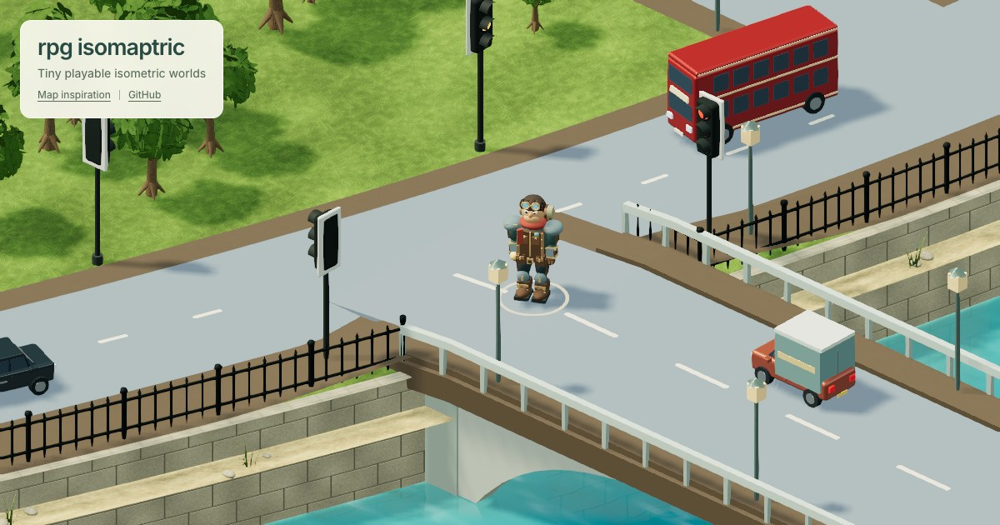</a>
    </td>
    <td width="50%" align="center" valign="middle">
      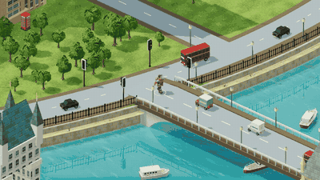
    </td>
  </tr>
</table>

https://github.com/user-attachments/assets/3212fd84-550a-4bce-9fa4-1f4871d053b8

[▶ Watch the gameplay video on YouTube](https://youtu.be/l_WwsOZ4Jgw)

## Two worlds, shared little systems

- **Explore by default.** Walk, run, or click open ground to fly there along a smooth obstacle-clearing arc. A gentle zoom breathes out and back in, with no landing impact or camera shake.
- **A miniature London.** Westminster, a live four-face clock tower, Tower Bridge, the London Eye, the Gherkin, an abbey, gardens, and a curved Thames. Most geometry and materials are generated in code.
- **A waterfront Dubai.** 28 skyline towers, the coastal Burj Al Arab, three sculptural waterfront landmarks and 27 limestone residences, a sheltered marina and three shipping bridges. 1,100 palms and broadleaf trees plus 1,800 low shrubs bring the landscape into the streets. [Dubai construction notes](docs/DUBAI.md).
- **Cities in motion.** London has 44 vehicles across cars, buses, cabs, vans, trucks, bicycles and motorcycles; left-hand traffic, timed signals and player avoidance. 22 boats leave fading world-space wakes and pass beneath three bridges. Dubai uses 36 vehicles with right-hand traffic, eight signal junctions, 18 moving motor/sailing yachts, and 20 moored yachts across five connected piers.
- **Day and night.** Warm clock rings, softly blue Eye capsules, occupied windows, 205 street lanterns, red rooftop beacons, and a world-space moon with a critically damped entrance. Dubai adds illuminated tower suites, softly lit glass shells and 149 waterfront street lights. Appearance persists through loading and location changes.
- **A playful sandbox.** “Bomb objects” fires straight, fiery shells up to 50 m, with projected blast previews and water splashes. Plant trees within 50 m, including on cleared plots. Reload restores the city.
- **Camera and touch controls.** Slow arrival zoom, smooth follow, Birdview, free orbit, pinch, and a ghost-preview teleport. Separate pointer tracking supports simultaneous touch movement, running and tool use.
- **Small details that hold up close.** Tiled roofs on every face, modeled goggles and armor, British railings and hydrant markers, glazed telephone boxes, bridge ramps and flush road paint.

| Day | Night |
| --- | --- |
| 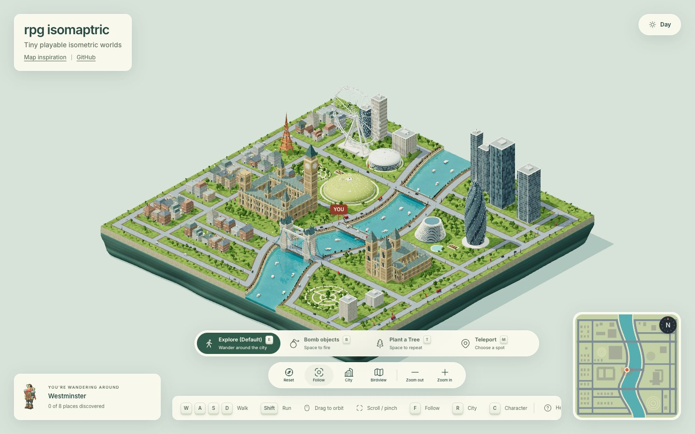 | 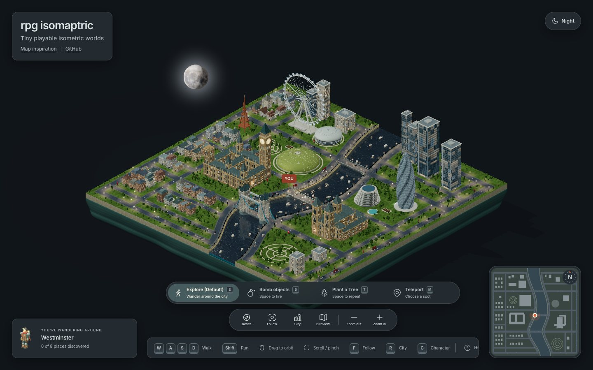 |

| Westminster | London Eye at night |
| --- | --- |
| 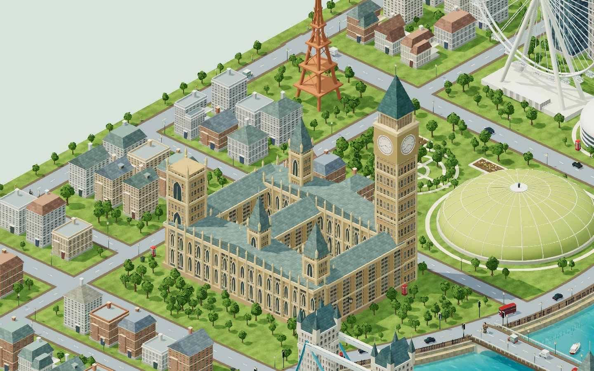 | 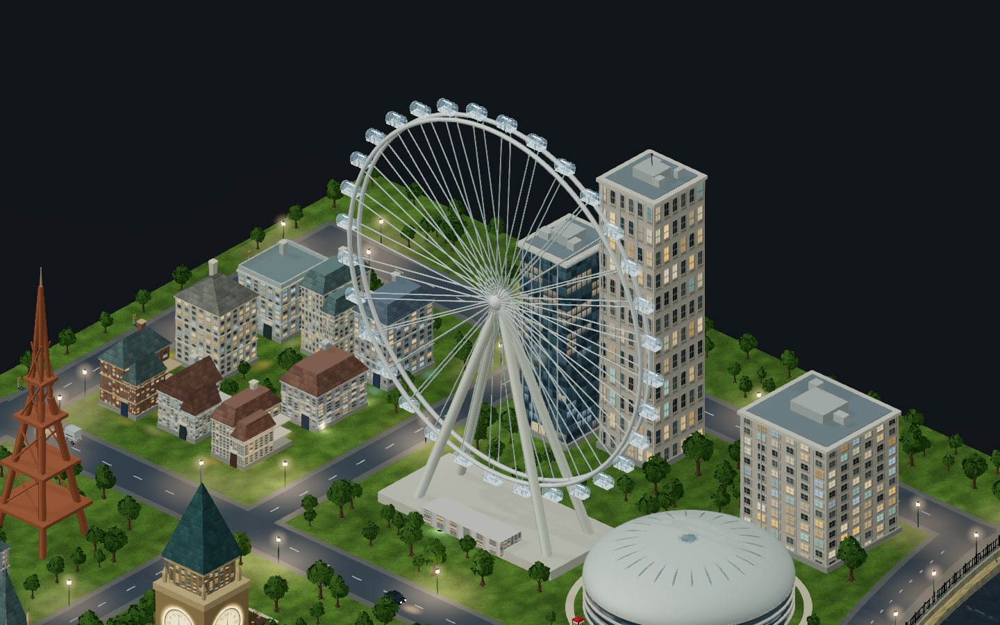 |

| Glass skyline | The explorer |
| --- | --- |
| 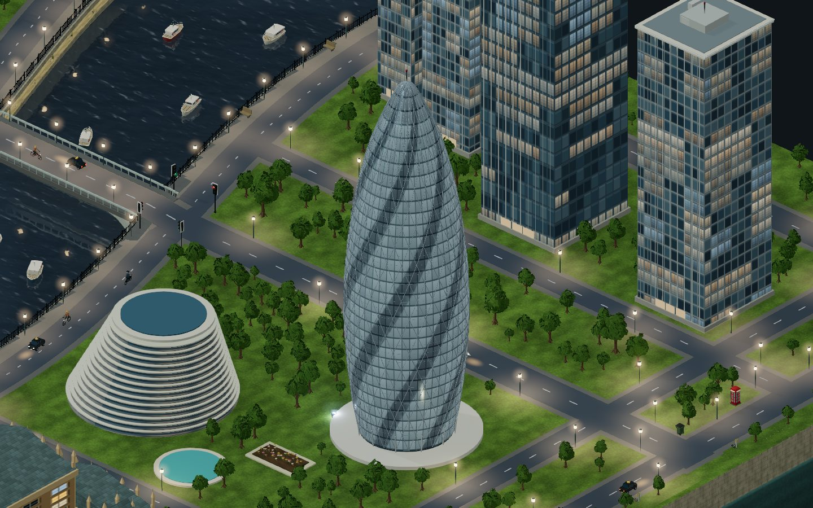 | 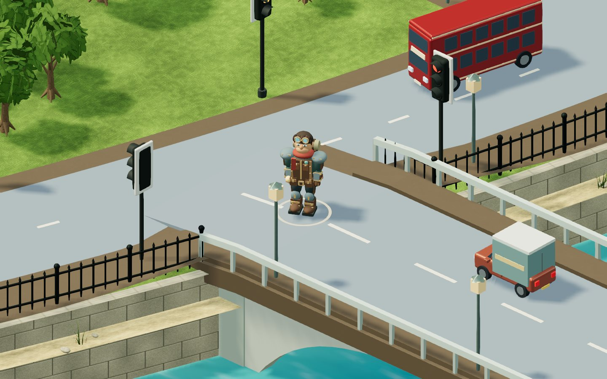 |

## Chapter 002 · Dubai

| Marina island by day | Skyline at night |
| --- | --- |
| 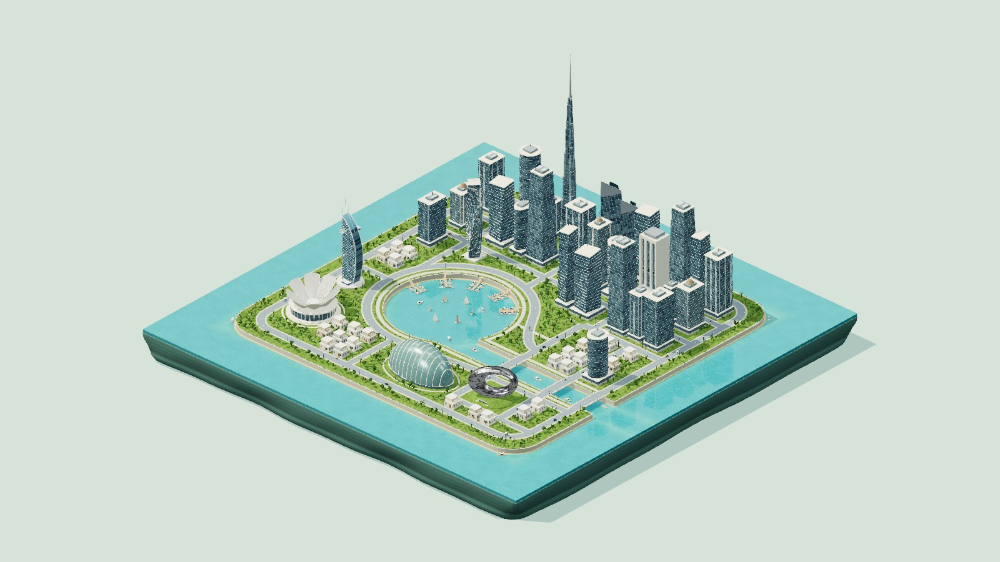 | 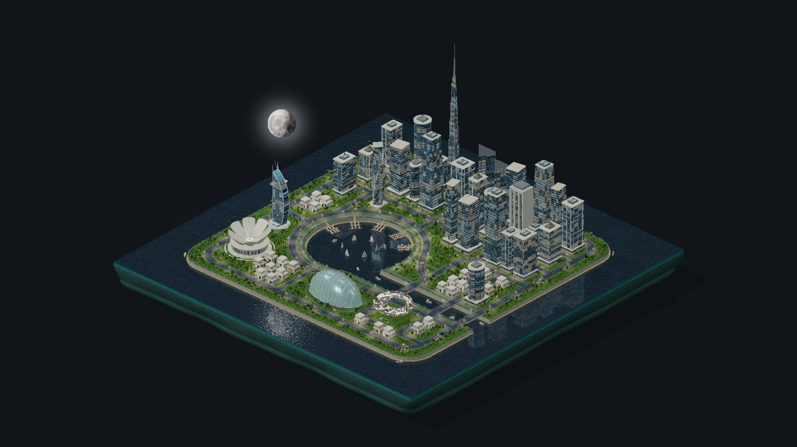 |

| Sculptural waterfront | The same explorer in Dubai |
| --- | --- |
| 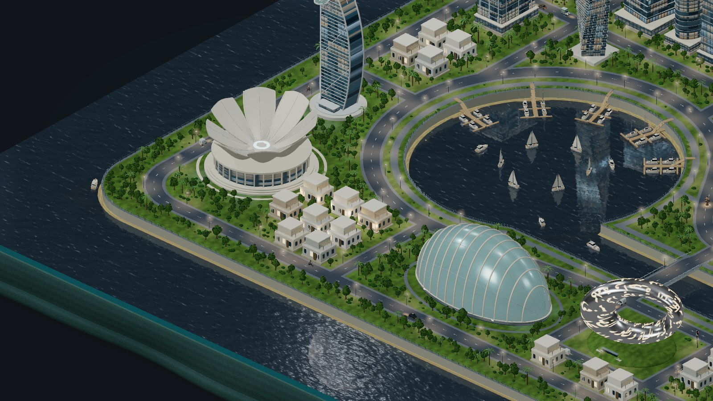 | 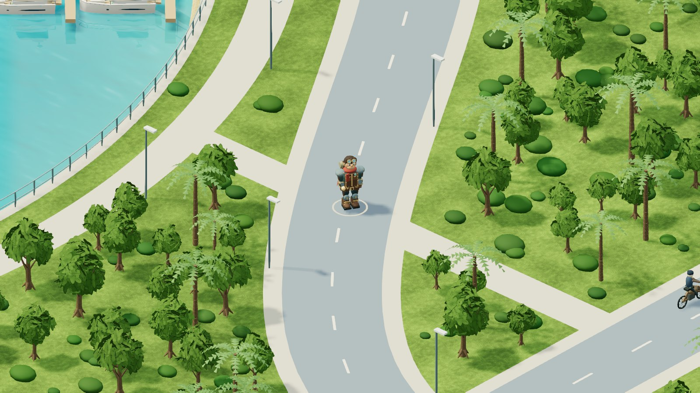 |

| Marina yachts and piers | Museum of the Future at night |
| --- | --- |
| 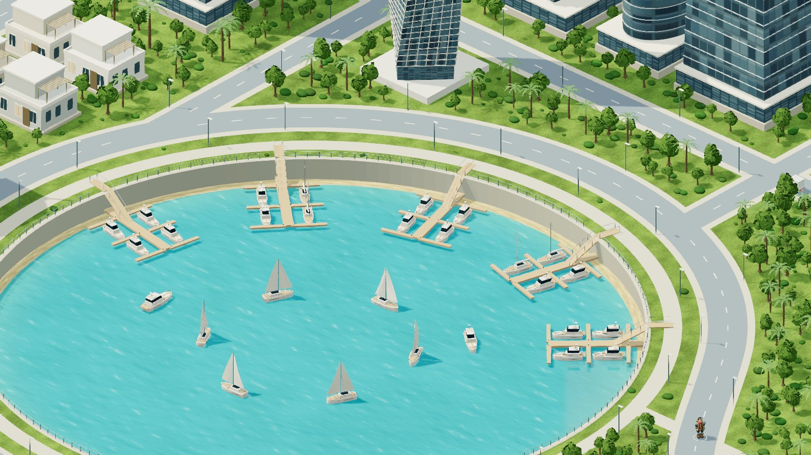 | 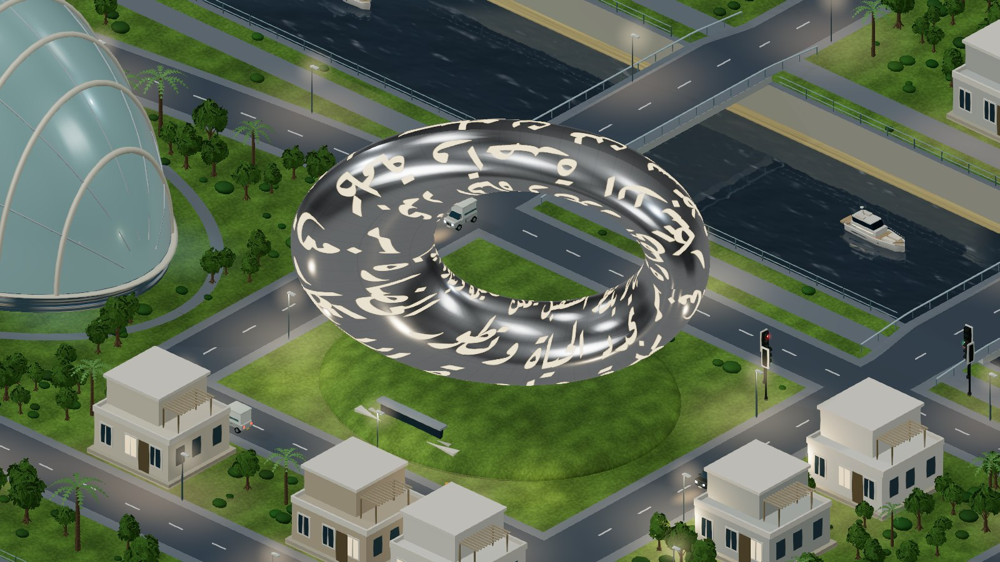 |

| Burj Al Arab on the coast | Dubai landmark skyline |
| --- | --- |
| 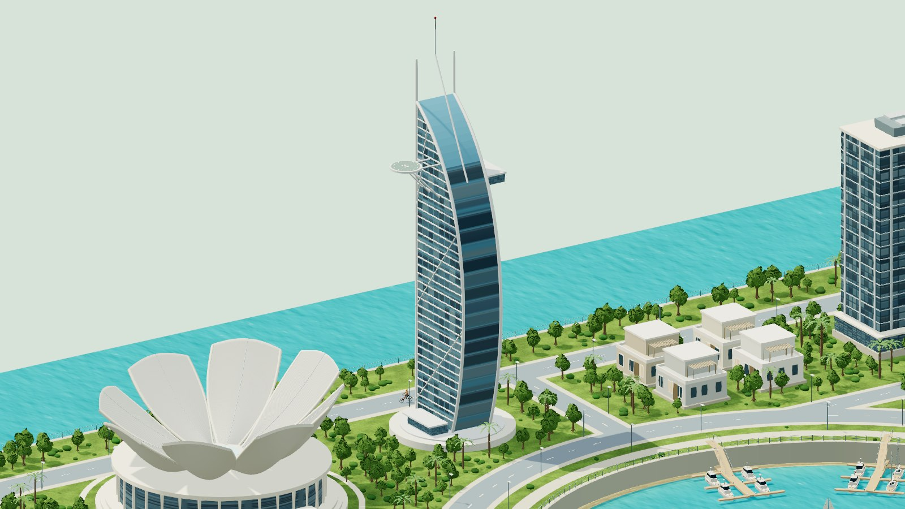 | 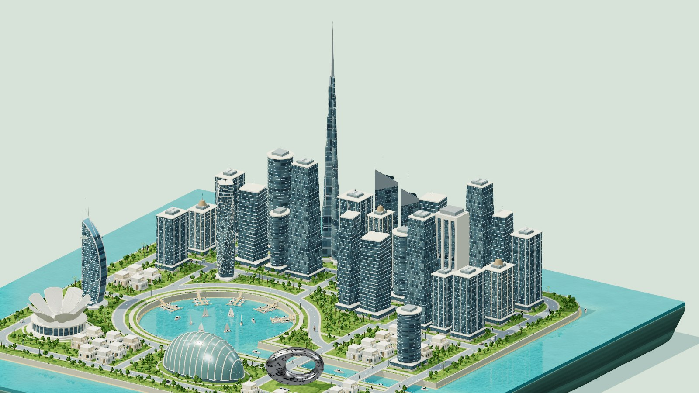 |

## Run it

Use **Node.js 24** and a browser with WebGL 2.

```sh
npm ci
npm run dev
```

Vite prints the development URL. For the production build and complete automated checks:

```sh
npm run check
npm run preview
```

There is no backend, account, API key, paid service, or external runtime asset request. `dist/` is a static website. The lockfile pins dependencies; `npm ci` reproduces the install.

## Play

| Action | Control |
| --- | --- |
| Explore / fly to clear ground | `E`, then click or tap |
| Walk / run | `WASD` or arrows / hold `Shift` |
| Bomb objects | `B`, then click or hold `Space` |
| Plant a tree | `T` equips and plants; click / `Space` repeats |
| Teleport with a ghost preview | `M`, choose a spot, click or `Enter`; arrows move the ghost |
| Orbit / pan / zoom | Left drag / right drag or two fingers / wheel or pinch |
| Follow / city / character | `F` / `R` / `C` |
| Straight-down follow | Birdview button |
| Day / night | Sun or moon button |
| Change world | London / Dubai at the top; arrow keys then Enter or Space when focused |
| Help / cancel | `?` / `Escape` |

The location URL is shareable (`?world=london` or `?world=dubai`), and the last selected location is remembered. Changing worlds rebuilds the scene and resets its temporary sandbox edits. Focus the canvas to use gameplay keys. Mobile and tablet offer a directional pad and independent Run and tool buttons. Explore has no weapon or red marker. Invalid water and occupied destinations cannot be used for travel. The separate teleport tool moves the character immediately and glides the camera while preserving zoom.

## How it works

The interesting work is in the constraints between systems, not just the landmark meshes:

| Technique | What it achieves |
| --- | --- |
| One shared street and river plan | Rendering, collision, traffic, planting, teleporting and the minimap agree about usable space. |
| Instanced vegetation and merged geometry | 950 London trees or 1,100 Dubai trees share species-specific bark and foliage layers; static surfaces are batched while destructible objects retain their identity. |
| Bounded local lighting | A pool of 12 nearby point lights and one batched ground-wash layer support hundreds of visible fixtures without one dynamic light per bulb. |
| Projected targeting shaders | Circular bomb and planting previews follow roofs, hulls and terrain rather than disappearing below them. |
| Analytic camera and travel curves | Frame-rate-independent arrival, moon damping, teleport glides and smooth flight with reduced-motion alternatives. |
| Geometry-level regression checks | Tests inspect the built city, including street corners, bridge triangles, traffic separation and reachable landmarks. |

Read [the engineering guide](docs/ENGINEERING.md) for architecture, algorithms, rendering tradeoffs and module ownership. [World authoring](docs/WORLD-AUTHORING.md) explains how to approach the next location using the implemented location boundary while keeping the character and game systems shared. [Contributing](CONTRIBUTING.md) includes asset and media workflows. [Release validation](docs/RELEASE.md) records checks and measured budgets.

## License and credits

Original code, procedural scene definitions and documentation are **MIT licensed**, copyright © 2026 Rahul Chakraborty ([hckmstrrahul](https://github.com/hckmstrrahul)). Reuse requires retaining the copyright and license notice; visible in-app credit is welcome but not required by the project's MIT license.

Third-party assets keep their own licenses. The small NVIDIA material/bin set is **CC BY 4.0**; lunar maps are credited to **NASA's Scientific Visualization Studio**. See [NOTICE](NOTICE), [NVIDIA attribution](public/assets/nvidia/manifest.json), [Moon credits](public/assets/moon/CREDITS.md), and the [in-app credits](https://rpg-isomaptric.vercel.app/credits.html).
