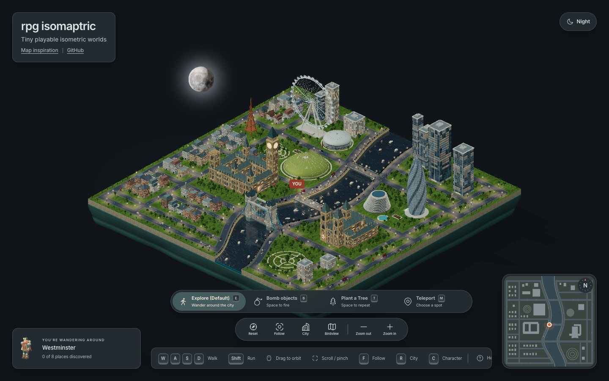
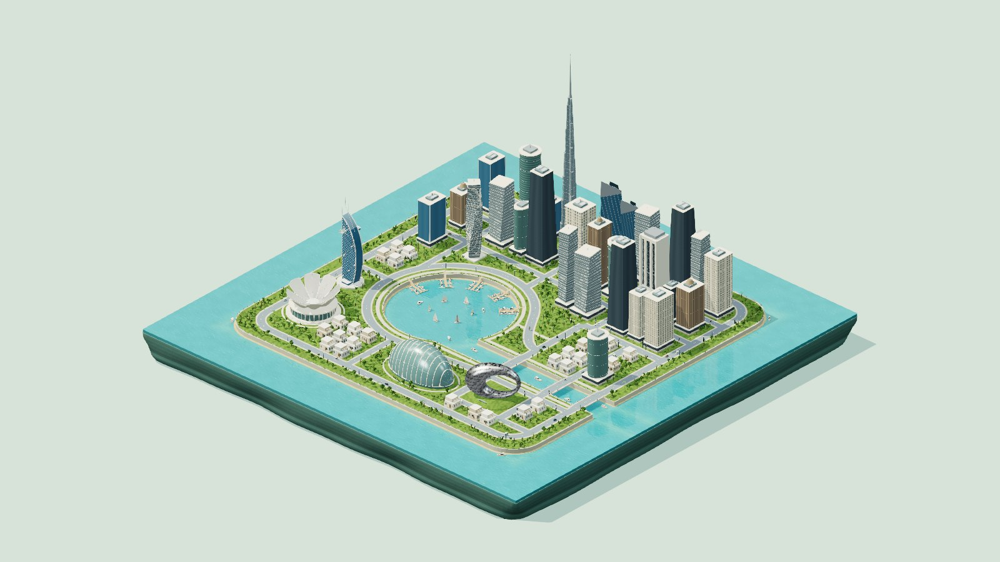
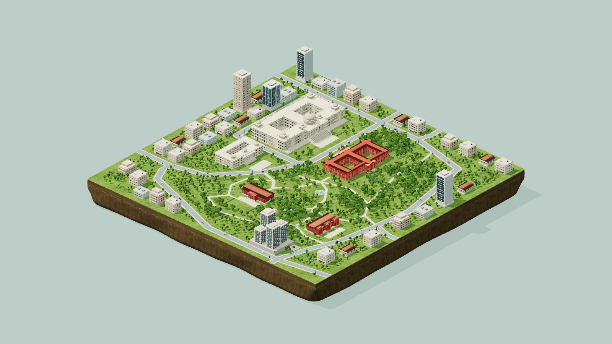
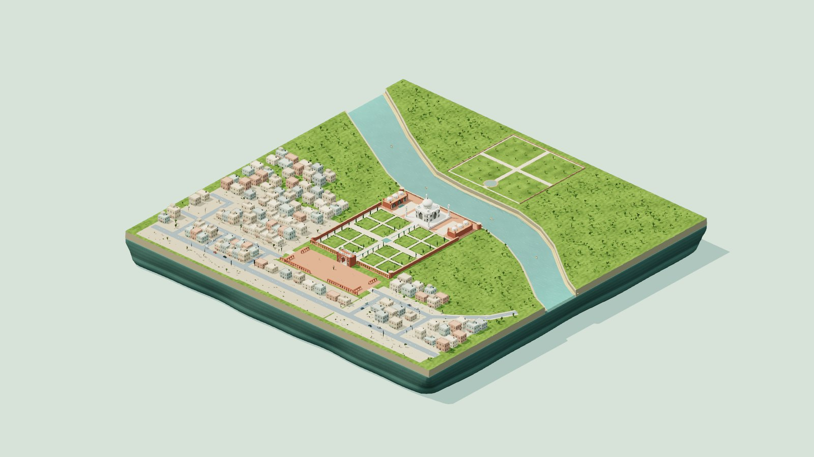
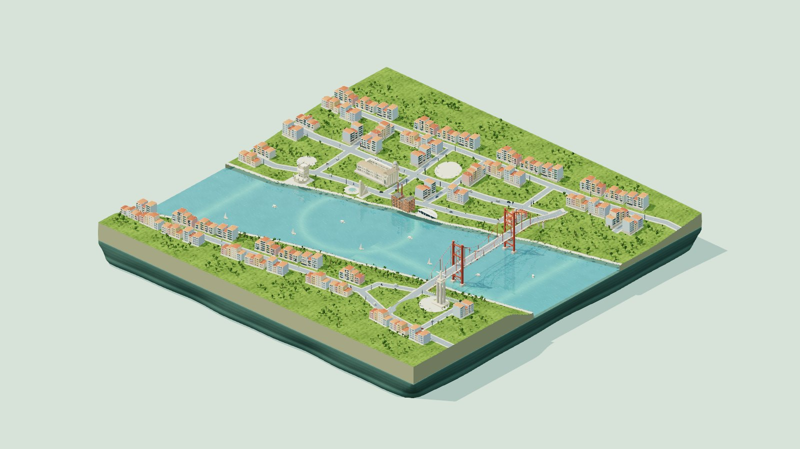
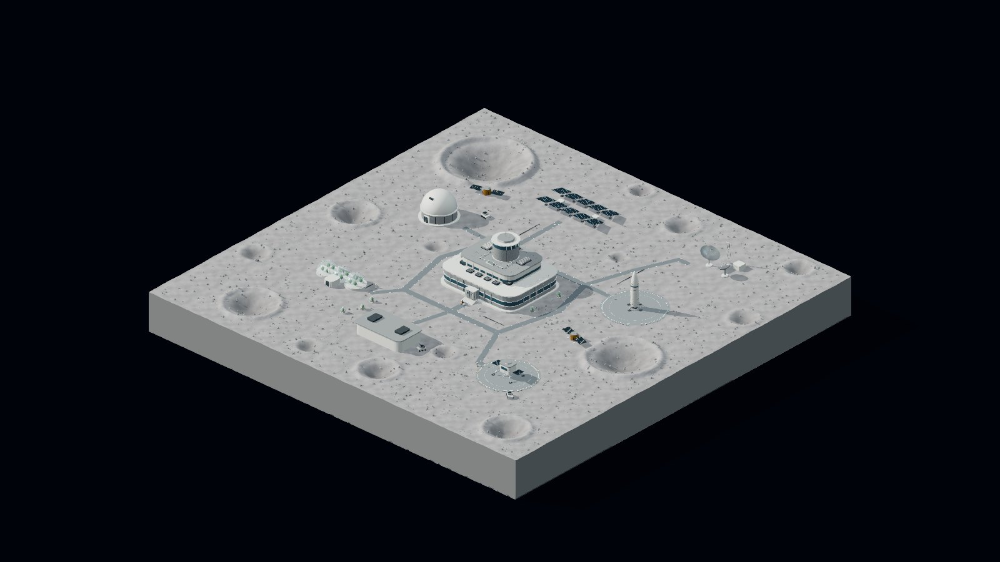

# rpg isomaptric

Six tiny playable isometric worlds built with Three.js. Explore city landmarks and a fictional Moon base, watch traffic and day/night lighting, or reshape the scene with a destructible sandbox.

[Play in your browser](https://rpg-isomaptric.vercel.app) · [Gameplay video](https://youtu.be/l_WwsOZ4Jgw) · [Build a world](docs/WORLD-AUTHORING.md)


## Choose a world

| World | Explore |
| --- | --- |
| [London](https://rpg-isomaptric.vercel.app/?world=london) | The Thames, Westminster, Tower Bridge and moving river traffic. |
| [Dubai](https://rpg-isomaptric.vercel.app/?world=dubai) | A waterfront skyline, palms, residences and a yacht marina. |
| [Bengaluru](https://rpg-isomaptric.vercel.app/?world=bengaluru) | Cubbon Park and the surrounding civic district. |
| [Agra](https://rpg-isomaptric.vercel.app/?world=agra) | The Taj Mahal, charbagh gardens, Yamuna and Taj Ganj. |
| [Lisbon](https://rpg-isomaptric.vercel.app/?world=lisbon) | Belém, Alcântara and Almada, with a labeled Sintra excursion. |
| [Moon Base](https://rpg-isomaptric.vercel.app/?world=moon) | Craters, habitats, solar arrays and greenhouse planting. |

The cities are artistic compositions with simplified scale and geography. They are not navigation maps. Moon Base is fictional. Interiors, multiplayer and saved-world persistence are not implemented.

## Run locally

Requires **Node.js 24** and a browser with **WebGL 2**.

```sh
git clone https://github.com/hckmstrrahul/rpg-isomaptric.git
cd rpg-isomaptric
npm ci
npm run dev -- --port 5188
```

Open the URL printed by Vite. No account, API key or backend is required. Runtime assets are bundled; a production build is a static site in `dist/`.

```sh
npm run build
npm run preview
```

## Play

| Action | Control |
| --- | --- |
| Walk / run | `WASD` or arrow keys / hold `Shift` |
| Explore / fly to clear ground | `E`, then click or tap |
| Grenade Gun | `B`, then click or hold `Space` |
| Plant a Tree | `T` equips and plants; click or `Space` to plant again |
| Orbit / pan / zoom | Left drag / right drag or two fingers / wheel or pinch |
| Follow / city / character view | `F` / `R` / `C` |
| Straight-down follow | Birdview button |
| Day / night | Sun or moon button |
| Travel to Moon Base | Click the Moon in the night sky |
| Help / cancel | `?` / `Escape` |

Focus the canvas for gameplay keys. Mobile and tablet have a directional pad and separate Run and tool buttons. The location selector changes worlds; its `?world=` URL can be shared. Switching worlds or reloading resets sandbox edits.

<details>
<summary>World gallery</summary>

| London at night | Dubai |
| --- | --- |
|  |  |
| **Bengaluru** | **Agra** |
|  |  |
| **Lisbon** | **Moon Base** |
|  |  |

Images are captures from the playable renderer.

</details>

## Development

Only the selected world loads. Each scene shares its spatial plan with collision, traffic, travel, planting and the minimap. Instanced vegetation, merged geometry and a bounded local-light pool keep detailed worlds manageable.

Run the automated tests, scene/UI audits and production build together:

```sh
npm run check
```

| Guide | Covers |
| --- | --- |
| [Engineering](docs/ENGINEERING.md) | Architecture, rendering and shared systems. |
| [World authoring](docs/WORLD-AUTHORING.md) | Adding a location while reusing controls and game systems. |
| [World scope](docs/WORLD-EXPANSION.md) | Geographic references and artistic interpretation. |
| [Dubai](docs/DUBAI.md) | The waterfront world's construction. |
| [Contributing](CONTRIBUTING.md) | Development, asset and media workflows. |
| [Release checks](docs/RELEASE.md) | Validation commands and budgets. |

[Original map composition inspiration](https://x.com/hckmstrrahul/status/1729860085982040454).

## License and credits


Original code, procedural scene definitions and documentation are **MIT licensed**, copyright © 2026 Rahul Chakraborty ([hckmstrrahul](https://github.com/hckmstrrahul)). Reuse requires retaining the copyright and license notice; visible in-app credit is welcome but not required by the project's MIT license.

Third-party assets keep their own licenses. The small NVIDIA material/bin set is **CC BY 4.0**; lunar maps are credited to **NASA's Scientific Visualization Studio**. See [NOTICE](NOTICE), [NVIDIA attribution](public/assets/nvidia/manifest.json), [Moon credits](public/assets/moon/CREDITS.md), and the [in-app credits](https://rpg-isomaptric.vercel.app/credits.html).
