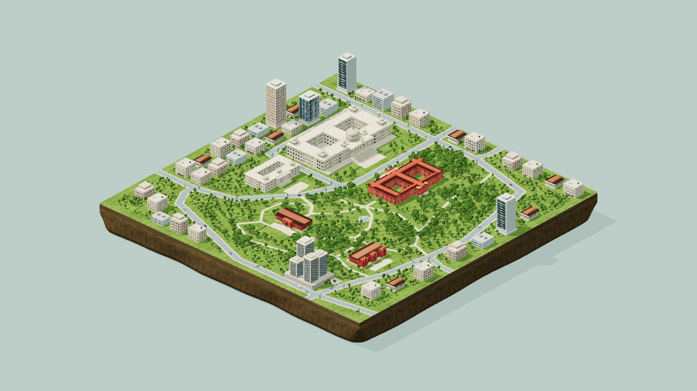
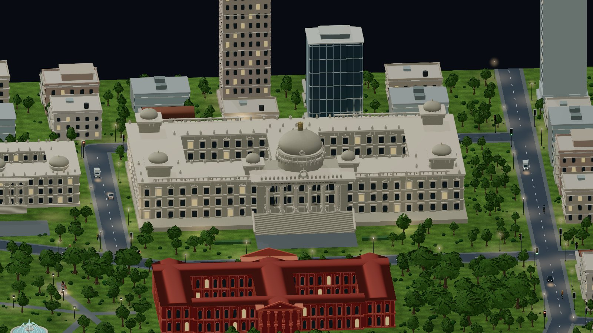
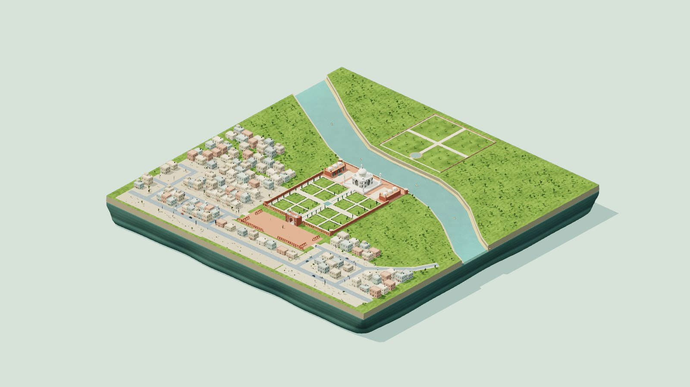
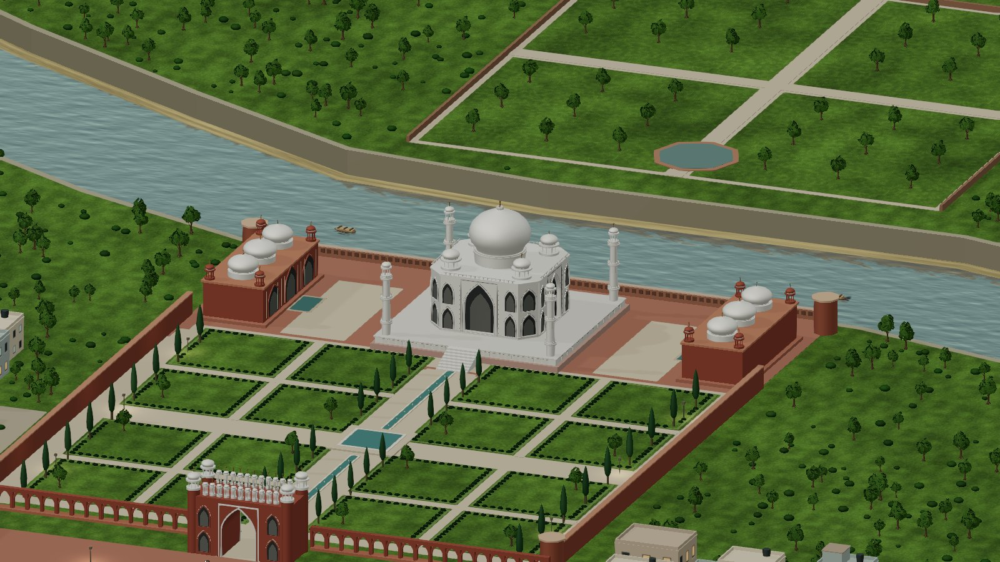
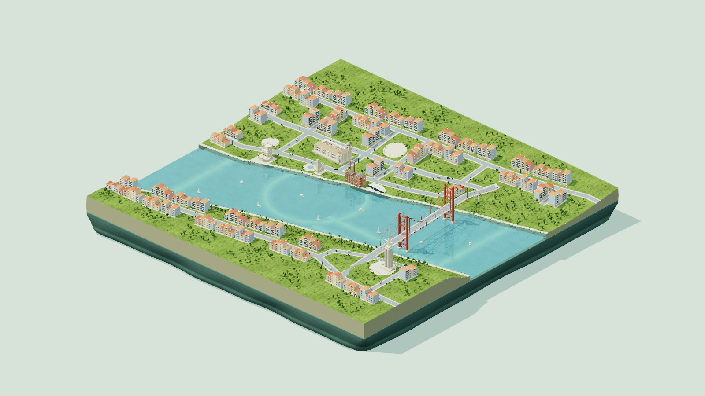
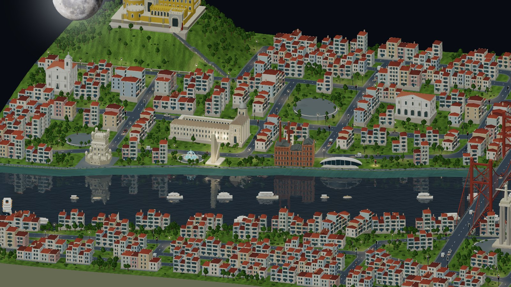
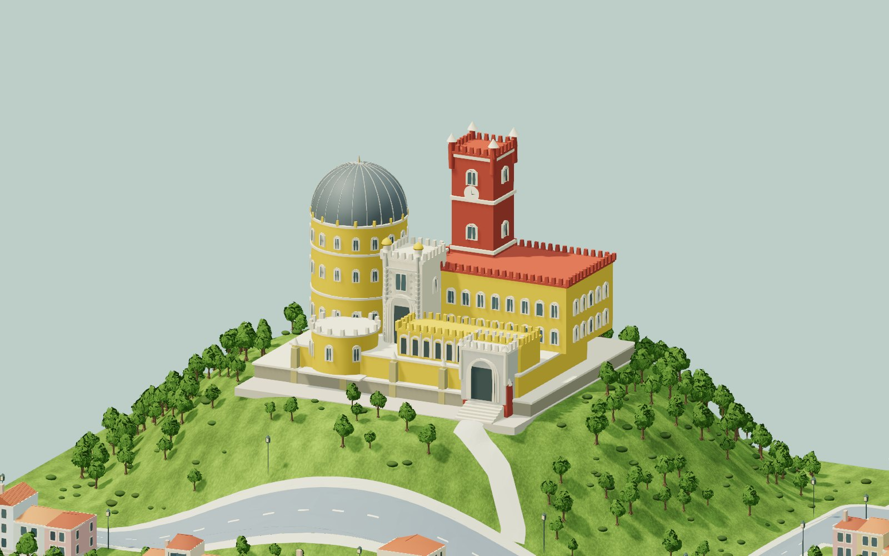
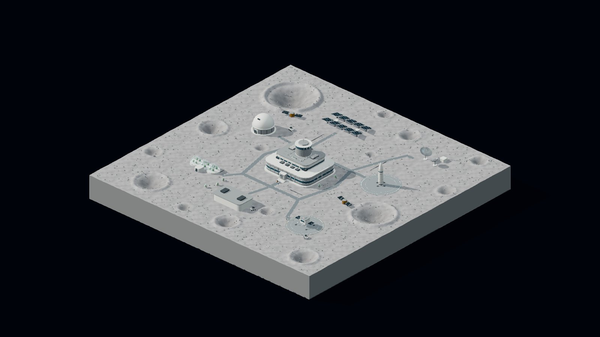
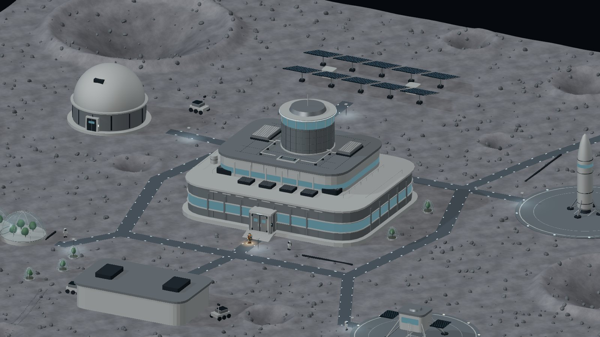

# rpg isomaptric

**Tiny playable isometric worlds**

[Play London](https://rpg-isomaptric.vercel.app/?world=london) · [Play Dubai](https://rpg-isomaptric.vercel.app/?world=dubai) · [Bengaluru](https://rpg-isomaptric.vercel.app/?world=bengaluru) · [Agra](https://rpg-isomaptric.vercel.app/?world=agra) · [Lisbon](https://rpg-isomaptric.vercel.app/?world=lisbon) · [Moon Base](https://rpg-isomaptric.vercel.app/?world=moon) · [Engineering guide](docs/ENGINEERING.md) · [Build another world](docs/WORLD-AUTHORING.md) · [MIT license](LICENSE)

Six miniature playable worlds share one explorer, traffic, day and night, and a destructible sandbox. Choose **London, Dubai, Bengaluru, Agra, Lisbon**, or **Moon Base**, a fictional lunar world, with the pill selector at the top.

[Map composition inspiration](https://x.com/hckmstrrahul/status/1729860085982040454). London and Dubai are artistic city compositions. The three newer terrestrial chapters use real landmark relationships within simplified, artistically scaled districts: Cubbon Park, the Taj riverfront, and Belém–Alcântara/Almada with a clearly labelled Sintra hilltop excursion. They are not navigation maps. Moon Base depicts an invented settlement. Interiors, multiplayer and saved-world persistence are not implemented. [Research, scope and production process](docs/WORLD-EXPANSION.md).

<table>
  <tr>
    <td width="50%" align="center" valign="middle">
      <a href="https://rpg-isomaptric.vercel.app"></a>
    </td>
    <td width="50%" align="center" valign="middle">
      
    </td>
  </tr>
</table>

https://github.com/user-attachments/assets/3212fd84-550a-4bce-9fa4-1f4871d053b8

[▶ Watch the gameplay video on YouTube](https://youtu.be/l_WwsOZ4Jgw)

## Six worlds, shared little systems

- **Explore by default.** Walk, run, or click open ground to fly there along a smooth obstacle-clearing arc. A gentle zoom breathes out and back in, with no landing impact or camera shake.
- **A miniature London.** Westminster, a live four-face clock tower, Tower Bridge, the London Eye, the Gherkin, an abbey, gardens, and a curved Thames. Most geometry and materials are generated in code.
- **A waterfront Dubai.** 28 skyline towers, the coastal Burj Al Arab, three sculptural waterfront landmarks and 27 limestone residences, a sheltered marina and three shipping bridges. 1,100 palms and broadleaf trees plus 1,800 low shrubs bring the landscape into the streets. [Dubai construction notes](docs/DUBAI.md).
- **Three researched city districts.** Bengaluru’s enlarged granite legislature, grounded red civic buildings, office towers and Cubbon Park fountain; Agra’s grand Taj, charbagh, Yamuna and dense Taj Ganj housing; Lisbon’s limestone monuments, varied tiled-roof neighborhoods, hills and Tagus suspension bridge. A wooded corner contains the **Pena Palace · Sintra** excursion.
- **A lunar world.** Cratered terrain, pressure habitats, landing pads, gold-foil satellites, a solar farm and a crater-relief minimap. Planting creates a tree in a sealed greenhouse.
- **Only the selected world loads.** Chapter plans and geometry are separate dynamic imports. London’s asset pack and Dubai’s lettering load only in their own chapters; a location change releases the previous scene. Dry worlds skip river reflections.
- **Cities in motion.** London has 44 vehicles across cars, buses, cabs, vans, trucks, bicycles and motorcycles; left-hand traffic, timed signals and player avoidance. 22 boats leave fading world-space wakes and pass beneath three bridges. Dubai uses 36 vehicles with right-hand traffic, eight signal junctions, 18 moving motor/sailing yachts, and 20 moored yachts across five connected piers.
- **Day and night.** Warm clock rings, softly blue Eye capsules, occupied windows, 205 street lanterns, red rooftop beacons, and a textured moon that rises smoothly with consistent shading. Dubai adds illuminated tower suites, softly lit glass shells and 147 waterfront street lights. Selected boats have warm occupied cabins; a few yachts and launches carry restrained deck strings, while Yamuna rowboats carry seated people and small warm lanterns. Appearance persists through loading and location changes.
- **A playful sandbox.** “Grenade Gun” fires straight, fiery shells up to 50 m, with projected blast previews and water splashes. Plant trees within 50 m, including on cleared plots. Reload restores the city.
- **Camera and touch controls.** Slow arrival zoom, compass-icon Follow, Birdview, free orbit and pinch. The minimap stays north-up while its camera needle tracks your orbit. Separate pointer tracking supports simultaneous touch movement, running and tool use.
- **A trip to the Moon.** Click the Moon in the sky to open Moon Base. Selecting or loading the lunar world always begins with **“To the moon...”**.
- **Continuous backgrounds.** The backdrop fills the screen in every world, by day and night, including low camera angles and wide zooms. Cast shadows keep the miniature grounded without exposing a rectangular background-plane edge.
- **Connected and grounded.** City roads meet at joined junctions and continue to the miniature's cut edges. Signals face their approaches; traffic runs on tested circulating routes. Every world starts the explorer near its center on accessible ground. Discoveries update the counter silently.
- **Small details that hold up close.** Tiled roofs on every face, modeled goggles and armor, British railings and hydrant markers, glazed telephone boxes, bridge ramps and flush road paint.

| Day | Night |
| --- | --- |
|  |  |

| Westminster | London Eye at night |
| --- | --- |
|  |  |

| Glass skyline | The explorer |
| --- | --- |
|  |  |

## Chapter 002 · Dubai

| Marina island by day | Skyline at night |
| --- | --- |
|  |  |

| Sculptural waterfront | The same explorer in Dubai |
| --- | --- |
|  |  |

| Marina yachts and piers | Museum of the Future at night |
| --- | --- |
|  |  |

| Burj Al Arab on the coast | Dubai landmark skyline |
| --- | --- |
|  |  |

## Chapter 003 · Bengaluru

The inland Cubbon Park civic district: a larger Vidhana Soudha, Attara Kacheri, mature park canopy, a flowing fountain and varied office towers. Cars and cyclists circulate on the connected civic ring. Street and park lights cast a slightly brighter, wider warm wash at night.

| Day | Night |
| --- | --- |
|  |  |

## Chapter 004 · Agra

A grander Taj Mahal beside the Yamuna, with four detached minarets, mosque, jawab, charbagh and Great Gate; Mehtab Bagh lies across the river. The monument and precinct are artistically enlarged, with 184 varied dwellings around Taj Ganj. As the Moon rises, a dedicated white fill gradually lights only the Taj’s marble surfaces, with clean edges and dark arch recesses. Seventy-two tourists visit the gardens by day, walk through the gate into nearby homes at dusk, and emerge gradually at dawn. Seated rowers and passengers ride the Yamuna boats; 83 street and garden lamps light the district through the existing twelve-light pool.

| Day | Night |
| --- | --- |
|  |  |

## Chapter 005 · Lisbon

Belém–Alcântara and Almada face one another across the Tagus: limestone monuments, 822 dwellings in compact attached neighborhoods, gently rolling residential terrain, narrower streets, a flowing fountain and the 25 de Abril Bridge. Houses vary in height and use deeper terracotta and rust tile colors. MAAT and Central Tejo follow the riverbank while leaving the promenade open. Twenty-five vessels mix launches, sails, yachts, catamarans, ferries and one large ship. Pena Palace stands on a wooded corner hill, explicitly labelled as a **Sintra excursion**; this is an artistic inset rather than its real geographic position. Its road follows a gently graded bench with a continuous capped retaining edge and a separate stepped palace approach. White parish-style and civic buildings draw on Portuguese architectural references without relocating a named church into the district.

| Day | Night |
| --- | --- |
|  |  |



## Chapter 006 · Moon Base

A **fictional settlement** on cratered lunar terrain, with pressure habitats, gold-foil satellites, solar arrays, rovers and contained greenhouse planting. White service-road markers glow more clearly at night. Its minimap uses subtle crater relief while retaining the shared game controls and default subtitle. Reach it through the location selector or by clicking the Moon in another world's night sky.

| Sunlit terrain | Base lights |
| --- | --- |
|  |  |

These gallery images are captures from the playable renderer. [Research and geographic scope](docs/WORLD-EXPANSION.md) · [City refinement review](docs/latest-refinement-review.md) · [Taj white-marble review](docs/taj-white-review.md).

## Run it

Use **Node.js 24** and a browser with WebGL 2.

```sh
npm ci
npm run dev -- --port 5188
```

Vite prints the development URL. For the production build and complete automated checks:

```sh
npm run check
npm run preview
```

There is no backend, account, API key, paid service, or external runtime asset request. `dist/` is a static website. The lockfile pins dependencies; `npm ci` reproduces the install.

## Play

| Action | Control |
| --- | --- |
| Explore / fly to clear ground | `E`, then click or tap |
| Walk / run | `WASD` or arrows / hold `Shift` |
| Grenade Gun | `B`, then click or hold `Space` |
| Plant a Tree | `T` equips and plants; click / `Space` to plant again |
| Orbit / pan / zoom | Left drag / right drag or two fingers / wheel or pinch |
| Follow / city / character | `F` / `R` / `C` |
| Straight-down follow | Birdview button |
| Day / night | Sun or moon button |
| Travel to Moon Base | Click the Moon in the night sky |
| Change world | Location pill at the top; arrow keys then Enter or Space when focused |
| Help / cancel | `?` / `Escape` |

The location URL is shareable (`?world=london`, `dubai`, `bengaluru`, `agra`, `lisbon` or `moon`), and the last selected location is remembered. Changing worlds rebuilds the scene and resets its temporary sandbox edits. Focus the canvas to use gameplay keys. Mobile and tablet offer a directional pad and independent Run and tool buttons. The toolbelt has three modes: **Explore**, **Grenade Gun** and **Plant a Tree**. Explore is selected on load and has no weapon or red marker. Travel is part of Explore; there is no separate Teleport tab or `M` shortcut. Invalid water and occupied destinations cannot be used for travel. Click or tap a valid destination in Explore to fly there; the gentle zoom returns to its previous level on arrival.

## How it works

The interesting work is in the constraints between systems, not just the landmark meshes:

| Technique | What it achieves |
| --- | --- |
| One selected spatial plan | Rendering, collision, traffic, planting, Explore travel and the minimap share land, water, roads and terrain elevation. |
| Instanced vegetation and merged geometry | Each world’s trees share species-specific bark and foliage layers; static surfaces are batched while destructible objects retain their identity. |
| Bounded local lighting | A pool of 12 nearby point lights and one batched ground-wash layer support hundreds of visible fixtures without one dynamic light per bulb. |
| Projected targeting shaders | Circular bomb and planting previews follow roofs, hulls and terrain rather than disappearing below them. |
| Analytic camera and travel curves | Frame-rate-independent arrival, moon damping and smooth flight with reduced-motion alternatives. |
| Geometry-level regression checks | Tests inspect the built city, including street corners, bridge triangles, traffic separation and reachable landmarks. |

Read [the engineering guide](docs/ENGINEERING.md) for architecture, algorithms, rendering tradeoffs and module ownership. [World authoring](docs/WORLD-AUTHORING.md) explains how to approach the next location using the implemented location boundary while keeping the character and game systems shared. [Contributing](CONTRIBUTING.md) includes asset and media workflows. [Release validation](docs/RELEASE.md) records checks and measured budgets.

## License and credits

Original code, procedural scene definitions and documentation are **MIT licensed**, copyright © 2026 Rahul Chakraborty ([hckmstrrahul](https://github.com/hckmstrrahul)). Reuse requires retaining the copyright and license notice; visible in-app credit is welcome but not required by the project's MIT license.

Third-party assets keep their own licenses. The small NVIDIA material/bin set is **CC BY 4.0**; lunar maps are credited to **NASA's Scientific Visualization Studio**. See [NOTICE](NOTICE), [NVIDIA attribution](public/assets/nvidia/manifest.json), [Moon credits](public/assets/moon/CREDITS.md), and the [in-app credits](https://rpg-isomaptric.vercel.app/credits.html).
