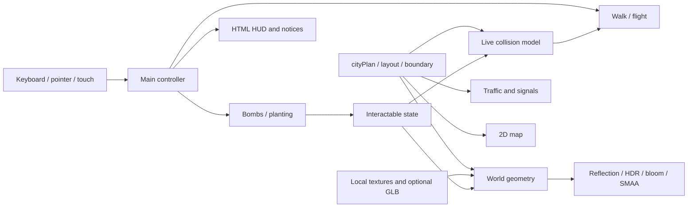

# Engineering guide

This is the implementation guide for **rpg isomaptric**, a series of location-inspired playable dioramas. London is Chapter 001; Dubai is Chapter 002. The application is a static TypeScript/WebGL 2 client: Vite builds it, Three.js renders it, a semantic HTML/CSS HUD handles controls, and Sonner runs in a small separate React root for notifications.

## Runtime and ownership

`main.ts` coordinates initialization, input, camera modes and the frame loop. Local assets and lunar maps load concurrently, then world construction creates geometry, collision records and simulation objects. The selected world constructor is loaded dynamically; Dubai skips the London-specific optional material/bin assets. Once ready, the loader disappears and an interruptible arrival zoom begins around the explorer on the central road.



| Area | Main modules | Responsibility |
| --- | --- | --- |
| Location | `worldLocation.ts`, `worlds/dubai/plan.ts` | URL/storage selection, chapter metadata, Dubai coastline and route data |
| Dubai geometry | `worlds/dubai/world.ts`, `architecture.ts`, `landmarks.ts`, `marina.ts`, `surfaces.ts` | Concentric harbour/road geometry, named landmark models, yacht berths, villas, palms and shared simulation assembly |
| City data | `cityPlan.ts`, `layout.ts`, `boundary.ts` | Street widths, landmarks, river profile, arrivals, footprint rules |
| Geometry | `world.ts`, `architecture.ts`, `geometry.ts` | Scene assembly, procedural architecture, material batching |
| Terrain and roads | `terrainBase.ts`, `roadSurfaces.ts`, `bridgeRamp.ts`, `embankment.ts` | Thick cutout, street corners, continuous deck ramps and bank joins |
| Nature | `nature.ts`, `trees.ts`, `landscaping.ts` | Surface maps, instanced forest, wind and river shader |
| Traffic | `traffic.ts`, `roadVehicles.ts`, `vehicles.ts`, `trafficSignals.ts` | Route distance, lane placement, spacing, junction phases, models |
| River detail | `boatWakes.ts`, `riverRailings.ts`, `reflections.ts` | Historical wake positions, bank safety rails, planar reflections |
| Player | `character.ts`, `exploreFlight.ts`, `characterPortrait.ts` | Articulation, projectile-like travel and actual-model portrait |
| Sandbox | `sandbox.ts`, `interactables.ts`, `effects.ts`, `blastProjection.ts`, `damageBars.ts` | Durability, moving targets, impacts, previews, reusable trees |
| Camera | `arrivalZoom.ts`, `cameraGlide.ts`, `zoomInput.ts`, `teleport3d.ts` | Opening framing, destination picking and smooth controls |
| Lighting | `lighting.ts`, `windowLighting.ts`, `landmarkLamp.ts`, `liveClock.ts`, `moon.ts`, `moonMotion.ts` | Theme-aware emission, local-light pool, time and lunar motion |
| Interface | `hud.ts`, `style.css`, `map.ts`, `icons.ts`, `notifications.ts` | Responsive controls, minimap, icons and themed notices |
| Policy | `appearance.ts`, `motion.ts`, `inputFocus.ts`, `touchControls.ts` | Stored theme, reduced motion, scoped keys and independent contacts |
| Capture | `capture.ts`, `scripts/capture-media.mjs` | Deterministic media rendering; capture API excluded from normal builds |

## Shared spatial truth

The world uses X/Z for the ground plane and Y for height. Gameplay calls one world unit a metre. This is an interpretive scale, not surveyed London geography. The river boundary is open at the slab edges. `surfaceHeight` gives ground or bridge-deck elevation; water has a distinct lower level.

Roads have exactly three asphalt widths: **4.7 m** for bridges and their immediate approaches, **4 m** for main roads, and **3.2 m** for smaller streets. Land borders add **0.75 m** on either side. Junctions reserve full corner quadrants, so grass and furniture cannot cover pavement. Bridge deck polygons split at ramp creases rather than interpolating a single plane through the bank. Painted markings sit flush and do not cast shadows. The 2D map deliberately omits road borders.

London’s upper terrain perimeter stays square. Dubai has a rounded island coastline inside a wider square sea slab; its bay and open channel share one concave coastline polygon. The same dry-ground query drives collision, teleporting, planting and clipped lighting. Dubai’s bay, promenade and curved road are concentric. Its stroked roads use mitered joins and butt ends; bridge ramps sample elevation creases and widen continuously, avoiding a second overlapping asphalt rectangle.

For London, only the buried portion of the **18-unit** slab tapers and rounds organically. There is no outer perimeter footpath. River railings join parapets outside the drivable width; clear bridge approaches remain usable. Placement checks include conservative full footprints and tree crowns, not just object origins.

Destruction changes live collision state. Movement, planting and teleport eligibility read that same state, so a demolished plot becomes useful immediately. A planted tree acquires its own collision and damage record. The minimap uses live object state too.

## Flight and camera motion

Explore starts unarmed. A short click on eligible visible ground starts flight; drag and multi-touch gestures do not. The flight calculates clearance against the entire route, including thin obstacles between endpoints. For each intersected expanded rectangular footprint, the solver evaluates entry and exit parameters and chooses a sufficient arc rise.

For normalized eased progress `u`, the trajectory is:

```text
u = (1 - cos(π × progress)) / 2
position = lerp(start, destination, u)
position.y += 4 × rise × u × (1 - u)
```

The endpoint is copied exactly on completion. Pose blends into a forward flying lean, then smoothly returns upright. Retargeting starts from the current aerial position and pose. Flight time grows gently with distance and clearance. A `sin²` envelope reduces zoom by up to 14% and returns it to the original zoom; manual zoom cancels that automatic lens movement. There is **no landing impact, smoke puff, bounce, or camera shake**. Reduced motion goes directly to the destination.

The opening camera holds for 450 ms, then zooms over four seconds. Sine easing plus interpolation in log magnification keeps the wide end from rushing. It settles at 6× on desktop or 8× in compact layouts. Camera input interrupts it. These are orthographic magnification factors, not browser zoom percentages.

Explore uses the shared 3D destination picker to reject foreground occlusion, water and occupied space. Click or tap valid ground to fly there. The former separate Teleport tab, `M` shortcut and ghost selector are removed. Birdview uses a wide straight-down camera with exponential follow panning.

## Traffic, bridges and water

London’s 44-vehicle fleet follows eight routes with distance-based sampling. Left-hand lane offsets, route tangents and collision footprints use the same pose. Headway checks, junction reservations and coordinated avoidance of the stationary explorer prevent vehicles stacking in the starting area. Six signal junctions use green, amber, clearance, and red-and-amber phases; conflicting directions cannot receive green together. Signal backs are separate surfaces rather than coplanar overlays.

Boats use lower water and guided bridge channels. Tests sweep the actual boat bounds against bridge deck, arch and pier triangles; a centerline-only clearance test would miss the mast and hull edges. Boats remain moving water-level damage targets, then stop and sink on destruction.

Wake history stores **world-space** samples rather than attaching rings to a moving boat. Two widening, broken foam arms and a central wash fade over 4.5 seconds. Old samples remain behind when a boat turns. The river combines procedural flowing normals, shallower bank coloration and a live reflection of the city. The 768×768 half-float planar reflection updates at most every 50 ms (20 Hz), using a mirrored orthographic camera and a water-level clipping plane. Rendering restores camera-related renderer state and hides the water during the reflection pass.

## Night rendering without a light per window

The night palette is cool charcoal with distinct slate road colors, restrained green vegetation and warm architectural accents. Day and night change shared material uniforms and registered emission/opacity, rather than reconstructing the scene.

London has 205 visible street lanterns; Dubai has 149. Their soft ground washes use 7.2 m radii, low opacity, and geometry clipped to the banks, decks and slab edge. Street and occupied-window washes share **one batched draw call**. A pool of **12 local point lights** eases between nearby fixtures around the camera target. Destroying a lamp or building removes its contribution. This makes local light believable while bounding dynamic lighting cost.

House-window colors and occupancy are stable and deterministic. Spill samples actual occupied lower windows on wall faces, not arbitrary points or roofs. Glass towers use suites and darker unoccupied areas. Six rooftop rods carry softened red pulses. The clock's four faces use browser-local time and warm annular illumination. Eye capsules keep their glass transparency while seats, floors, ceiling strips and glazing emit soft blue light. The wheel completes a diorama rotation in 45 seconds by day and 120 seconds by night without resetting its angle on a theme change.

The NASA-textured moon belongs to world space, so panning, orbit and zoom move it with the city. A spherical halo and restrained local illumination brighten its side of the scene. Its entrance and exit travel upward along one path. The analytic critically damped model uses mass 3, stiffness 75 and damping 30, with a 320 ms opacity time constant. It has no spring overshoot. Reduced motion fades without travel.

Postprocessing uses **single-sample half-float HDR → bloom → SMAA → output**. Bloom blends back into its input; using an invalidated multisample input had caused rectangular artifacts. Antialiasing the completed image avoids that failure while keeping leaf cutouts consistent in reflections and shadows.

## Geometry and targeting tricks

Static solids merge by compatible material with baked vertex colors. Destructible structures retain independent roots. Trees share two instanced layers for trunk and foliage, with 1,016 triangles in the shared tree template and variation in size, shape and leaf color. Destroyed tree slots can be reused without reviving old objects. Procedural normal and roughness maps add close-up surface detail without large texture downloads.

Slate roof UVs use independent planar mapping on every face at a consistent world scale. That prevents one spire face having elongated courses while its neighbor looks correctly tiled. Window mappings are confined to vertical facades. Telephone booths, railings, vehicles, character equipment and most architectural details are modeled locally.

The filled blast disk is projected through material shaders in world space. Its X/Z circular footprint shades actual fragments on terrain, roofs and hulls, so it follows object shape without becoming a flat card hidden under the geometry. Shader hooks preserve earlier material customization. Bomb aim is a thin red line at 65% opacity; planting uses green. Bombs travel along straight segments, check intervening collisions and moving targets, and choose water splashes versus land debris at impact. Both tools have a 50 m reach.

## Input, loading and accessibility

The appearance bootstrap runs before the application bundle. Saved day/night preference takes priority over the OS; blocked storage falls back to system preference. The HTML boot state and application loader use the same theme. Manual choices persist; without one, live system changes continue to apply.

Each touch action tracks its own set of pointer IDs. Releasing one finger does not cancel another held action. Blur clears held state. Gameplay keys are scoped to the canvas/body, so focused buttons and Help do not accidentally walk or fire. Tab navigation enables visible focus rings; ordinary pointer use does not leave them behind. Camera gesture alternatives are available in Help.

Reduced motion is observed live. A pauseable ambient clock freezes traffic, boats, water and wheel motion without large time jumps on resume. Travel and camera effects have immediate or reduced alternatives. The clock continues to report local time. Toasts announce useful range and error states; clearing an object does not add repetitive success messages.

The HUD has source-level name, ARIA and contrast checks, plus browser smoke checks. These do not establish complete screen-reader or WCAG conformance; see [UI validation](UI-AUDIT.md).

## Assets and deployment

All runtime assets are local. Optional NVIDIA concrete/metal maps and a simplified bin GLB have procedural fallbacks. The bin derivative has **3,797 triangles**, down from the 88,370-triangle source; the model plus six maps total **834,910 bytes**. Source revision, adaptations and attribution are retained beside the derivatives. NASA lunar map credits are separate.

The normal build excludes the writable media-capture API. A small read-only `window.__littleLondon.getState()` exposes runtime state for smoke checks. A capture preview enabled explicitly with `VITE_CAPTURE=1` renders reproducible stills and frames through the actual engine. The favicon is a transparent render of the actual character head. Social video is metadata-only and never fetched by the game itself.

Vercel serves the static build. Fingerprinted JS/CSS/font assets receive long immutable caching; stable-named media and source assets use shorter caching. GitHub Actions runs the same checks as local development on pushes and pull requests. No secrets or Vercel account files belong in version control.

## Validation and limits

Run `npm run check`: unit and geometry tests, city audit, UI source audit, TypeScript, and production build. Tests construct the real city without a WebGL renderer and cover reachable landmarks, street-corner paving, clear bridge approaches, actual ship/bridge geometry, continuous traffic, foliage budgets, shader hooks, dynamic destruction and input/motion policy.

CPU geometry tests cannot prove rendered appearance or GPU frame rate. Public-preview screenshots and interaction checks complement them. The renderer remains a detailed WebGL scene with a substantial main bundle; low-end-device performance needs real hardware profiling. World edits are session-only. The code is still London-specific in several modules; the next location should extract shared boundaries deliberately rather than duplicate `world.ts` wholesale.

## Location switching and Dubai

The top-centre pill uses keyboard-operable tabs with explicit `?world=` links. The URL takes precedence over the stored location. A chapter change navigates through the themed loader and constructs one fresh scene; it does not keep two renderers or cities alive. Shared engine and texture files remain browser-cacheable. Appearance persists; sandbox edits and discoveries currently reset.

Dubai contributes data and geometry without duplicating the character, input, camera, bomb/plant tools, wake simulation, reflection pipeline or postprocessing. `layout.ts` dispatches coastline and bridge queries; `cityPlan.ts` selects the road plan. Traffic accepts route loops, junctions, lane direction and vehicle count. `WorldObjects` supports separate reusable instance banks for palms and broadleaf trees. The minimap uses the same coastline and road data.

See [Dubai construction notes](DUBAI.md) for architectural and performance decisions, and [world authoring](WORLD-AUTHORING.md) for the current extension boundary.
